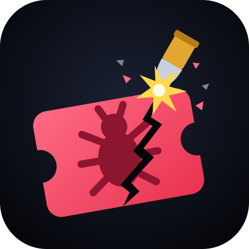
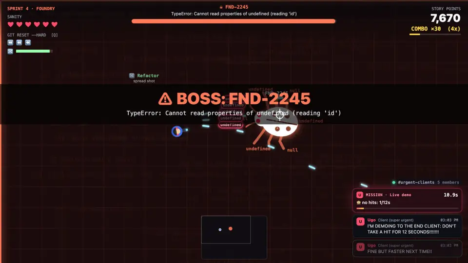

# Bug Killer

A top-down shooter where the enemies are the **open bugs in your backlog**. Every sprint is a project, every boss is that project's worst ticket, and every now and then a client pops into the chat with a "super urgent" mission.

**Play it at [bug-killer.giovannilondero.dev](https://bug-killer.giovannilondero.dev/)**, on desktop or on the phone.



```sh
pnpm install
pnpm dev        # http://127.0.0.1:5199
pnpm check      # typecheck + oxlint (Ritmo rules) + ritmo-devtools lint + headless tests
pnpm build && pnpm serve   # production on Node: game + run server on a single port (PORT, default 8080)
pnpm serve:cloudflare      # production as deployed, locally: the Worker and its Durable Object (http://localhost:8787)
```

`?tutti` in the URL unlocks every sprint for the session.

## How to play

| Control | Action |
|---|---|
| WASD / arrows | move |
| Mouse (hold) | aim and shoot |
| Space / Shift | dash (briefly invulnerable) |
| Q / E / right button | `git reset --hard`: clears the screen |
| P / Esc | pause |
| M | audio on/off |

Hover the crosshair over a bug to read its ticket.

- **Priority → enemy type.** Lowest/Low are weak, High are fast, Highest are tanks that spawn 3 regressions when they die.
- **Status → behaviour.** *Blocked/On hold* are shielded (half damage), *Ready for QA/UAT/review* may reopen (`REOPENED`), *In development* move erratically.
- **Sprints.** Glacier → Side Quests (seven small projects) → Keystone → Foundry. Projects, keys and tickets are made up (`src/content/backlog.ts`).
- **Bosses.** `GLC-37` the dispenser that only stops on a timeout, `QUIZ-276` the crash that restarts somewhere else, `KEY-3242` the 2FA that wants a second factor, `FND-2245` `TypeError: Cannot read properties of undefined`.
- **Clients** (made up): Ugo WRITES EVERYTHING IN CAPS!!!, Ornella is "following up on my previous email", Kevin sends you voice notes, Samanta asks "while you're at it", Gualtiero says "it worked on staging". A mission completed earns story points and a power-up. A mission failed means scope creep: new `ESC-*` bugs in the arena.
- **Resurrected bugs.** Every now and then a client swears a bug you closed "is not fixed yet": it comes back to the arena as a zombie 🧟 (tougher, and missing from the release notes until you close it again) while the client laughs in the chat and tells you to work harder.
- **Tobia** (Tech Lead) shows up when you're slow (too long without closing a bug, or bugs piling up) and asks "are you using the _tools_??", then leaves them next to you: 🤖 Tools, homing shots.
- **Power-ups:** 🔥 Hotfix, 🔀 Refactor, ☕ Coffee, 🛡️ Green tests, ⏪ git reset, 🍕 Pizza, 🤖 Tools (from Tobia only), 🧠 AI.
- At the end of a sprint: release notes with the closed tickets, copyable as Markdown.
- **Endless:** the ∞ card below the sprints. Every open bug from every project, picked at random, forever; every 6 waves one of the four bosses arrives, in rotation, and every boss beaten makes the next round harder (tougher, faster bugs, bigger waves closer together). It only ends when you burn out; your record stays in the menu.
- **Bonus calls:** every now and then a client calls you. On Meet a room appears in the arena: stay inside it for 5 seconds. On Slack their messages float around the arena: go read them all. Answering earns story points and a power-up; ignoring costs nothing but a passive-aggressive message. An arrow points the way when it's off screen.
- **Minimap:** the whole arena in a box, top right below the story points (bottom centre on phones, between the thumbs): bugs in their priority colour, bosses, power-ups, the call to answer, the mission's blocker ticket blinking, and a rectangle for what you can see.
- **AI:** the rarest drop. Once picked up, it places a turret on the spot that shoots the nearest bug on its own for 12 seconds (the points go to whoever picked it up). Every now and then it hallucinates and shoots at nothing.
- **Play together:** up to 4 developers on the same backlog. In the menu you pick a name (it stays saved) and create a run, which gets a code like `RUN-4821` and a `?run=RUN-4821` link to send your teammates, or you join one with its code. In the lobby the host picks the sprint and starts it. Everyone has their own colour and their name above their head; bugs chase whoever is closest, and waves and bosses scale with the number of players. Whoever burns out stays down until a teammate stands next to them for a few seconds; you lose when everyone is down. At the end of the run there's the team leaderboard and the host starts the next one. If you drop your connection, you rejoin in your own seat with the same name. Single player is unchanged and doesn't use the server.
- **Music:** an original 80s-style 8-bit loop (two pulse channels, triangle bass, noise drums), synthesized with WebAudio. The menu has a calm track (it starts on the first tap or key press, as browsers require); in game the loop speeds up for the boss and stops while paused; M mutes it along with the sound effects.
- **Mobile:** on touch devices two virtual sticks appear. The left one moves; the right one aims and shoots, with aim assist, and held still it shoots the nearest bug. There are also DASH and ⏪ `git reset --hard` buttons, plus pause and audio at the top. The chat gets compact, and in portrait the game asks you to rotate the phone. On Android (and iPad) starting a sprint switches to fullscreen locked in landscape, with a ⛶ button to exit; on iPhone, which doesn't allow it, the menu suggests "Add to Home Screen" (the manifest opens the game fullscreen).
- **Languages:** English (default) and Italian, from the EN/IT switch in the menu or with `?lang=it`; the choice stays saved. Bug titles are in English in both languages, like in a real backlog.

## Architecture

The simulation is a fixed-step (60 Hz) [Ritmo](https://github.com/typeonce-dev/ritmo) ECS, deterministic and headless; the browser is just a host.

- `src/sim/` — schema (components, resources, events), systems (`player`, `waves`, `movement`, `boss`, `combat`, `missions`, `interruptions`), schedule, and the `View` inspector the renderer reads. Randomness only from the seeded `Random`, trigonometry from `Ops`: same seed + same input = same game.
- `src/content/` — data: the made-up backlog, levels, clients. Closed tables with `satisfies Record<...>`. All text lives in `src/content/text/{en,it}.ts`, typed by `Strings` in `i18n.ts`; the simulation reads the language from the `Language` resource, fixed for the whole level.
- `src/host/` — input (keyboard + mouse + touch sticks → intents), renderer, client chat (DOM), WebAudio-synthesized audio (sound effects in `audio.ts`, music in the `music.ts` sequencer).
- `src/net/protocol.ts` — the messages between the browser and the run server (JSON over WebSocket, path `/runs`), with validation of everything that comes from the browser.
- `src/server/` — multiplayer runs: `rooms.ts` (rooms, lobby, names, each run's simulation, no networking), `socket.ts` (WebSocket with `ws` on any Node HTTP server), `main.ts` (production server on Node), `worker.ts` (the Cloudflare deploy: a Worker and one Durable Object holding every run). In development the plugin in `vite.config.ts` attaches runs to the dev server itself: `pnpm dev` is all you need.
- Rendering: `render-pixi.ts` draws with [Pixi](https://pixijs.com/) (WebGL). Every shape is painted once by the Canvas 2D painters in `paint.ts` into a texture, glow included, and each frame only places sprites: it looks the same as the Canvas renderer and keeps 60 fps with hundreds of bugs. `render.ts`, the Canvas 2D renderer drawing with the same painters every frame, is the fallback without WebGL and is forced with `?renderer=canvas`. Both draw only from the `View`, so solo and multiplayer render the same way.
- `bench/` (dev only) — `node bench/fixtures.ts` saves real views from headless play; with `pnpm dev` running, `node bench/shots.ts` screenshots them with both renderers and reports the differing pixels, and `node bench/run.ts` measures frame rates with crowds of 30–300 bugs (`CHROMIUM_PATH` picks the browser).
- The server is authoritative: it runs the same simulation at 60 Hz and sends the view at 30 Hz; browsers only send input (30 times a second) and draw by interpolating between two frames (`src/host/net.ts`).
- `test/simulation.test.ts` — an autopilot plays the levels headless with the same intents as a player, in teams too. `test/rooms.test.ts` — the rooms with fake browsers.

## Deploy

Production runs on Cloudflare Workers (`wrangler.jsonc`): the built game is static assets, and the runs live in a single Durable Object (`src/server/worker.ts`) running the same rooms as the Node server. GitHub Actions (`.github/workflows/ci.yml`) checks every pull request and deploys every push to `main`, once the repository has these settings:

| Setting | Kind | Value |
|---|---|---|
| `CLOUDFLARE_API_TOKEN` | secret | an API token from the "Edit Cloudflare Workers" template, limited to your account and the domain's zone |
| `CLOUDFLARE_ACCOUNT_ID` | secret | your Cloudflare account ID |
| `DEPLOY_DOMAIN` | variable | the custom domain, e.g. `bug-killer.example.com`, in a zone on the same account; the first deploy creates its DNS record |

Without `DEPLOY_DOMAIN` the workflow only checks, so a fork never tries to deploy. By hand: `pnpm exec wrangler login`, then `pnpm build && pnpm exec wrangler deploy --domain <your domain>`.

The Workers Free plan is enough for a hobby. Static files are free and unlimited, and single player never touches the server. The Durable Object gets 100,000 requests a day, and incoming WebSocket messages count 1 in 20: at 30 inputs a second, about 18 hours of play a day, counting every developer in every run together (twenty people playing for an hour use it up), reset at 00:00 UTC. Past the quota multiplayer stops answering until the reset, and the game says so; the Free plan never bills. Nothing is stored, so a deploy ends the runs in progress.

Since every run steps in that one object, the server holds at most 10 runs (`MAX_ROOMS` in `src/server/rooms.ts`), 2 of them from the same address, and the Worker takes at most 50 connections, 8 from the same address (`src/server/worker.ts`). Past any of these the game answers that the server is busy. A [rate limiting rule](https://developers.cloudflare.com/waf/rate-limiting-rules/) on `/runs` in the Cloudflare dashboard (one is free) also stops anyone opening sockets in a loop before they reach the Worker.

## License

[MIT](LICENSE)
